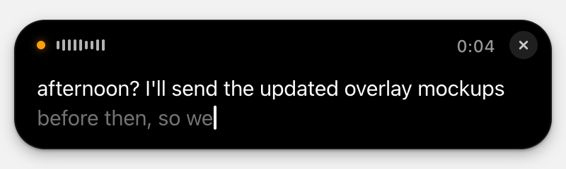
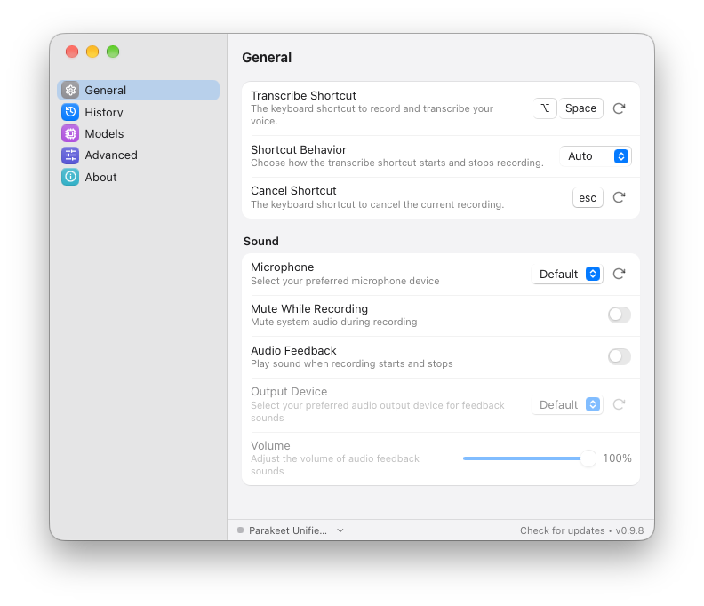
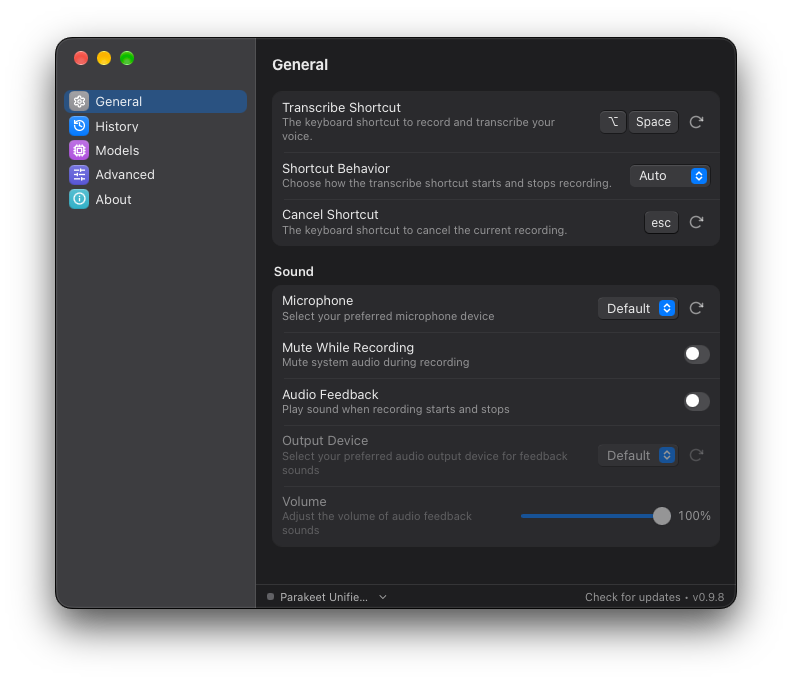
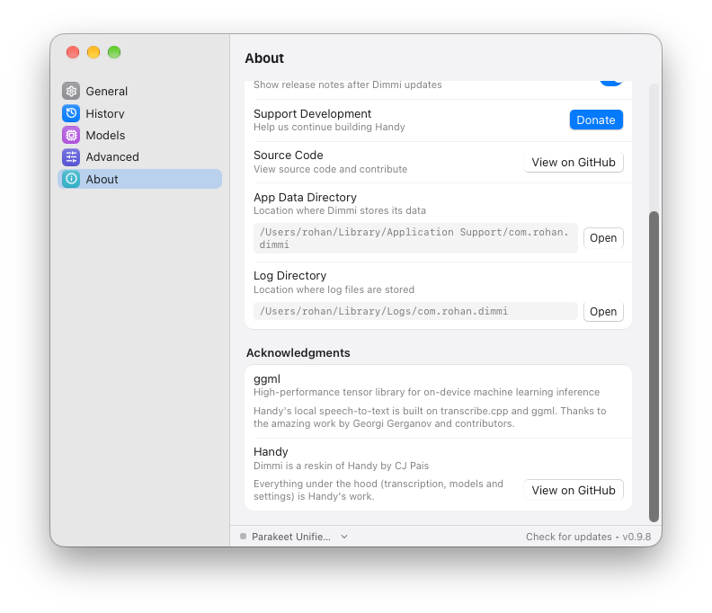

# dimmi

handy, with a coat of paint that matches the rest of my mac.



dimmi is a reskin of [handy](https://github.com/cjpais/Handy) by [cj pais](https://github.com/cjpais). that's the whole project. same app underneath, different clothes.

## why this exists

i use handy every single day. it has replaced most of my typing, and i say that as someone who types on a split keyboard with clicky switches because he enjoys it. it's how i talk to my agents and it's how i code now. hold a key, talk, let go, the words show up where my cursor is.

the one thing that bugged me was how it looked next to everything else on my screen. that's a me thing, not a handy thing. taste is personal and mine is annoyingly specific. so i reskinned it: a black island-style pill while you dictate, a settings window that looks like it came out of system settings, and a new icon.

dimmi is italian for "tell me". felt right for an app you talk to.

## all credit to cj

i want to be really clear about this. every bit of the real work here is cj's. the transcription engine, the models, the shortcuts, the paste logic, every setting in the app is handy. i changed css, swapped an icon and moved the traffic lights. i'm not going to pretend i built a speech-to-text app, because i didn't.

i picked handy as the base on purpose. it's fast, it runs fully offline, it's open source, and it just works. if dimmi is useful to you, thank cj, not me:

- star [handy](https://github.com/cjpais/Handy)
- support him at [handy.computer/donate](https://handy.computer/donate). the donate button inside dimmi still goes to him.
- if something breaks with transcription, models or shortcuts, check whether it happens in handy too before opening an issue there. if it only looks wrong in dimmi, that's on me, so open the issue here.

## screenshots

|                                               |                                                  |
| --------------------------------------------- | ------------------------------------------------ |
|     |  |
|  |       |



## what's different from handy

- **the overlay.** a black capsule like the dynamic island, with a waveform that moves with your voice. in live mode it grows into a card showing your text as you speak.
- **settings.** styled like macos system settings, with a translucent sidebar, grouped sections and your system accent color.
- **name and icon.** new name, new icon, new menu bar icons.
- **macos only.** releases are built for apple silicon and intel macs. on windows or linux, use handy.
- **updates** come from this repo's releases.

that's it. no new features, no behaviour changes. if cj adds something to handy, dimmi gets it when i merge.

## install

grab the latest `.dmg` from [releases](https://github.com/ro-hansolo/dimmi/releases).

i don't have an apple developer account, so dimmi isn't notarized and macos will block the first launch. to get past that, right-click **Dimmi.app** → **Open** → **Open**. if macos still says no:

```sh
xattr -dr com.apple.quarantine /Applications/Dimmi.app
```

dimmi is a separate app from handy as far as macos is concerned. it keeps its own settings, and you'll grant mic and accessibility permissions again. if you're coming from handy, quit it first. two apps fighting over the same shortcut gets weird.

## docs

everything works the same as in handy: features, settings, troubleshooting, building from source. read the [handy readme](../README.md).

## staying in sync with handy

```sh
git fetch upstream
git merge upstream/main
node scripts/rebrand.mjs   # puts the dimmi name back on any new strings
```

## license

mit, same as handy. cj's copyright stays right where it is. see [LICENSE](../LICENSE).
